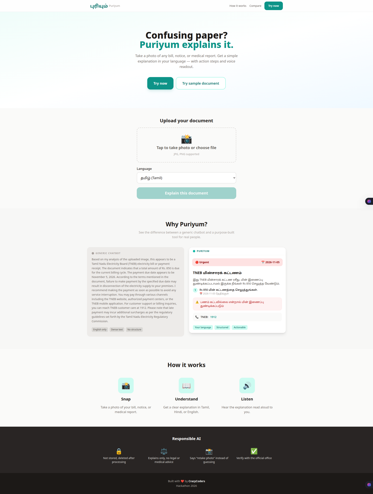
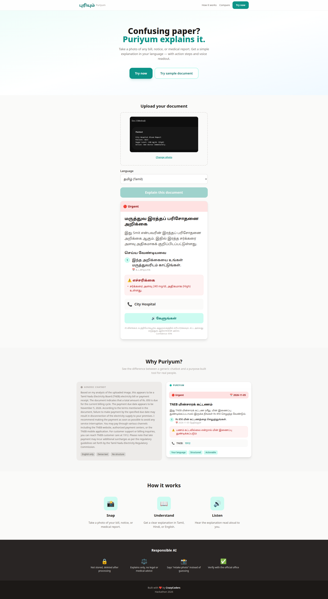
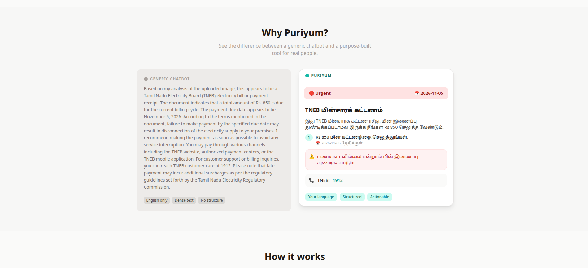
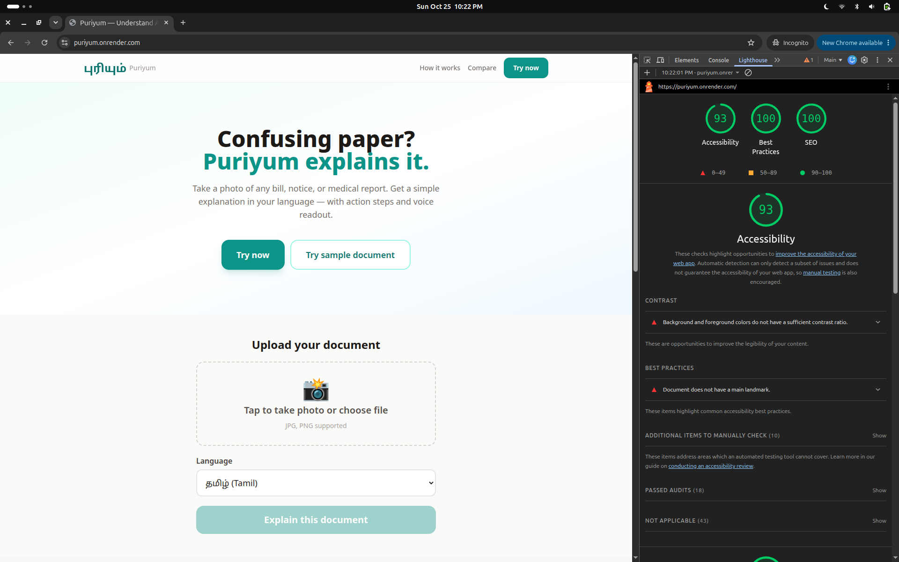
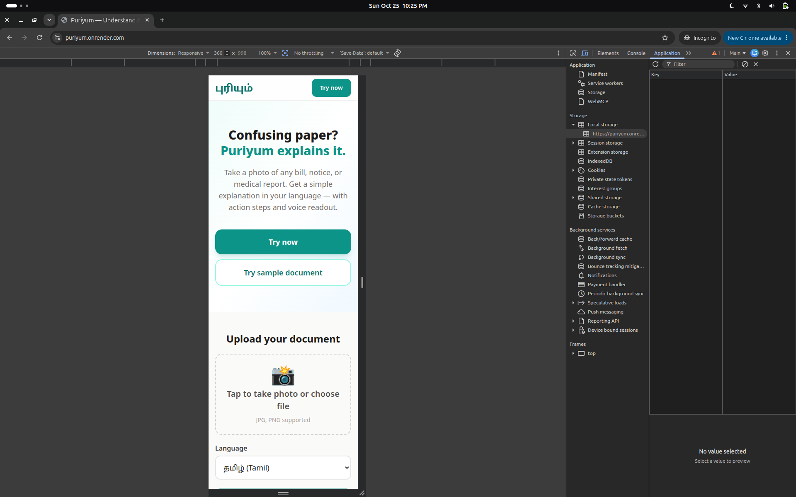

# Puriyum (புரியும்) — Confusing paper? Puriyum explains it.

> Snap a photo of any confusing official document. Get a plain-language explanation in **Tamil, Hindi or English**, a clear action list, an urgency badge, and a **voice readout**.

**Live demo:** https://puriyum.onrender.com
**Demo video:** `<ADD VIDEO LINK>`
**Team:** CrazyCoders · AI-Powered Website Building Hackathon '26 (Education Algorithm)
**Theme:** Beyond the Screen — Build for a Smarter, More Inclusive Future

> Tip: the first load on the free host can take ~50 seconds while the server wakes up. Use **Try sample document** for an instant, zero-API demo.



---

## The problem

Every family has someone who has stared at a letter they could not understand: an electricity disconnection notice, a bank letter, a medical report, a government form. For elderly people, low-literacy readers and migrants, these papers are written in dense, formal language, often in a language they do not read comfortably. The result is missed deadlines, penalties, power cuts and anxiety.

Generic chatbots can explain a document, but only if you can type a good prompt, read a long paragraph, and read English.

## The solution

Puriyum is a voice-first, accessibility-first web tool built for exactly these users.

1. **Snap** — take a photo or upload an image of the document.
2. **Understand** — a vision AI reads it and returns a fixed, structured card: what it is, what to do, deadline, urgency, risks, who to contact.
3. **Listen** — one tap reads the explanation aloud in the chosen language.



### What makes it different from a general chatbot

| Generic chatbot | Puriyum |
|---|---|
| Long English paragraph | Fixed structure every time: what / do / deadline / risk / contact |
| Needs prompt skill | One button, no typing |
| Reader must read | Voice readout, large font, high contrast |
| Guesses on unclear input | Refuses and asks for a retake |
| Output varies | Urgency colour-coded (red / amber / green), `tel:` link to call the office |



## Features

- Photo/camera upload, client-side image compression
- Tamil, Hindi, English output
- Structured JSON output enforced by schema
- Urgency badge with text label and icon (never colour alone), plus a rule-based urgency correction layer
- Risk flags quoted from the document
- Tap-to-call contact link
- Voice readout (server-side TTS)
- **Confidence gate:** blurry, cropped or non-document images are rejected with a "retake photo" message instead of a guess
- **Busy-state handling:** if the AI service is overloaded, users see "service busy" (never a misleading "retake photo")
- **Sample documents (cached, zero API):** bill and medical report with pre-generated audio, so the demo works even if the API is down
- Model fallback chain and retry logic

## How AI is used

- **Vision + language:** Google Gemini (multimodal) reads the document image and returns JSON that matches a Pydantic schema (`DocResult`).
- **Prompt design:** strict rules to read only what is visible, never invent numbers, keep all text in one language, and never give legal or medical advice.
- **Post-processing:** deterministic urgency correction in code so a disconnection threat or near deadline is never shown as "for information".
- **Speech:** gTTS generates Tamil/Hindi/English audio.

## Responsible AI

- **No storage:** uploaded images are processed in memory and not saved.
- **Explains only:** no legal or medical advice. For medical reports the tool only states which values the document marks as high or low and suggests showing the report to a doctor.
- **Says "I can't read this"** instead of guessing (confidence gate).
- **Visible disclaimer** on every result: AI explanation, verify with the official office.

## Accessibility

- Base font 20px+, high contrast, WCAG AA targeted
- Urgency conveyed with text and icon, not colour only
- Keyboard navigable, visible focus outlines, ARIA labels, `aria-live` result regions, skip link
- Buttons min 48px, mobile-first (tested at 360px)
- Respects `prefers-reduced-motion`
- Voice output for readers who cannot or prefer not to read
- Chrome Lighthouse audit run on the live site (screenshot below)



### Mobile view (360px)



## Tech stack

- **Backend:** Python, FastAPI, Uvicorn, Pydantic
- **AI:** Google Gemini API (vision + structured output), gTTS
- **Frontend:** HTML, Tailwind CSS (CDN), vanilla JavaScript
- **Hosting:** Render (free tier)

## Run locally

```bash
git clone https://github.com/SmitKapadia13/puriyum.git
cd puriyum
python3 -m venv venv
source venv/bin/activate
pip install -r requirements.txt
export GEMINI_API_KEY=your_key_here
uvicorn main:app --reload
```

Open http://127.0.0.1:8000

## Project structure

```
main.py              FastAPI app: /api/explain, /api/tts, static hosting
requirements.txt     Python dependencies
static/index.html    Landing page + tool UI
static/samples/      Cached sample docs (png, json, mp3)
screenshots/         Images used in this README
```

## API

- `POST /api/explain` — multipart: `file` (image), `lang` (English | Tamil | Hindi) → structured JSON. Returns HTTP 503 `{"error": "busy"}` if the AI service is unavailable.
- `POST /api/tts` — form: `text`, `lang` (en | ta | hi) → `audio/mpeg`.

## Limitations and future work

- Free-tier AI quota and hosting cold starts
- gTTS voices are functional but robotic; a neural TTS would sound more natural
- Planned: more Indian languages, WhatsApp bot, offline mode, reminder export (.ics)

## Team CrazyCoders

- Akshat Sarda (Team Leader)
- Smit Kapadia
- Mayank Chandrakar
- Sanket Aepa

Built for the AI-Powered Website Building Hackathon '26.